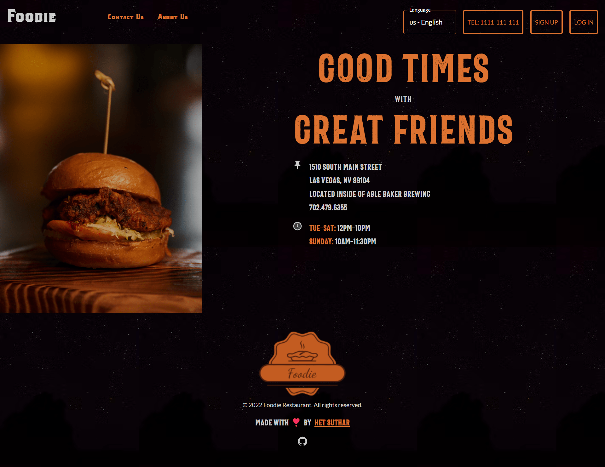
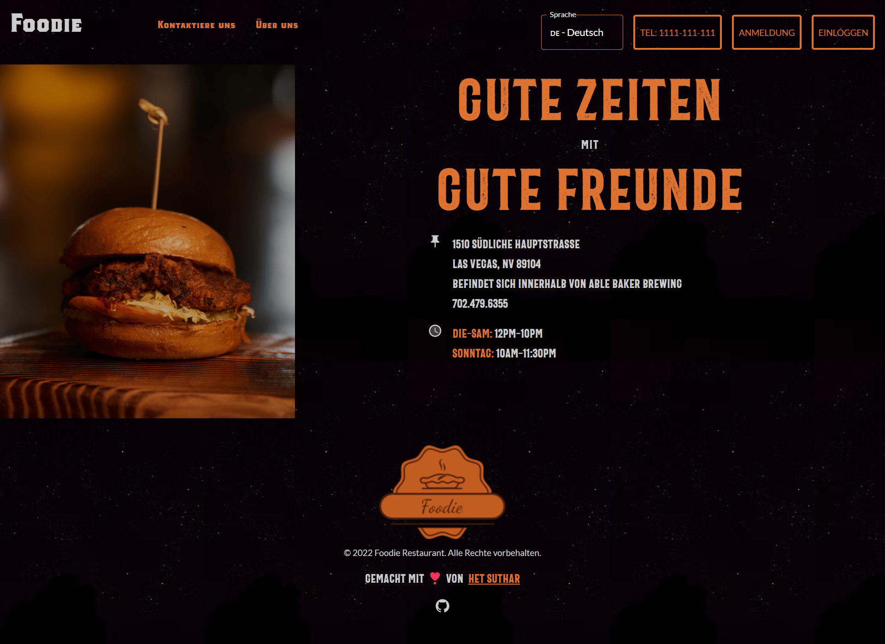
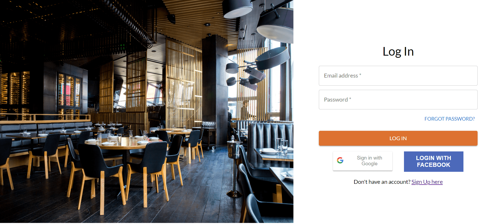
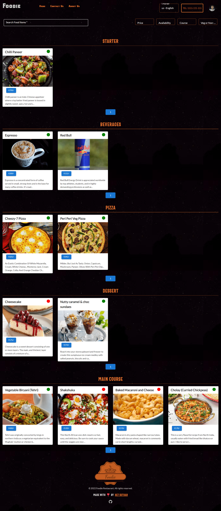
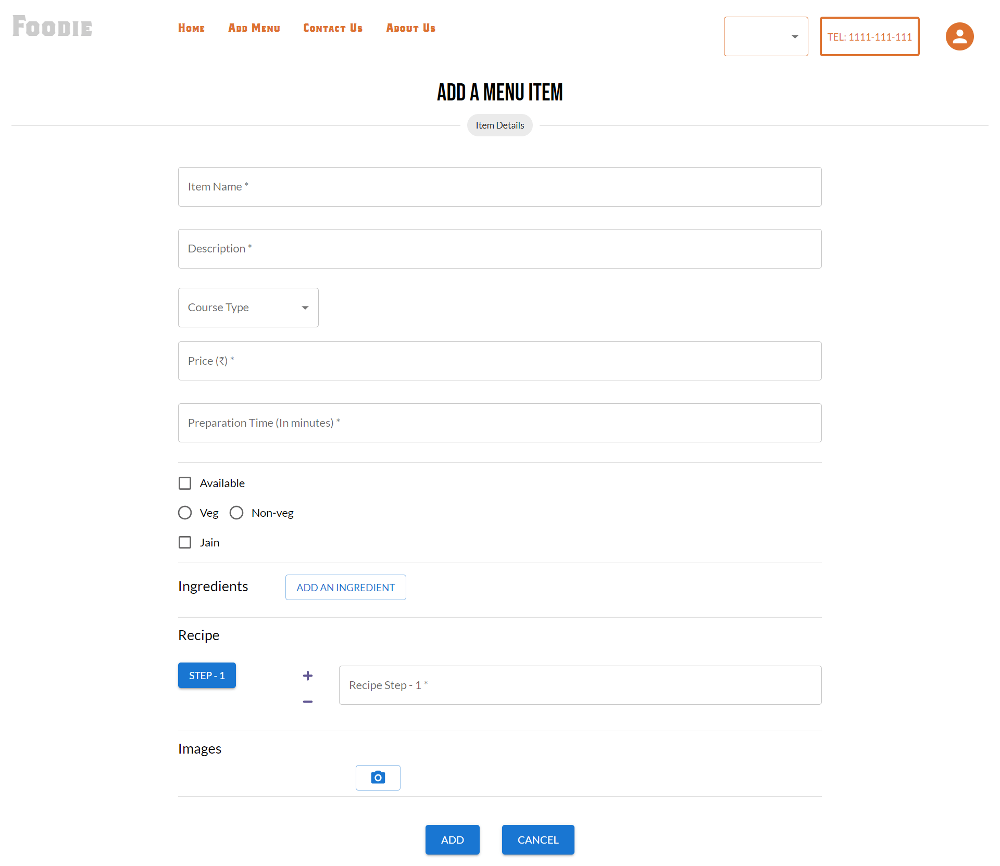
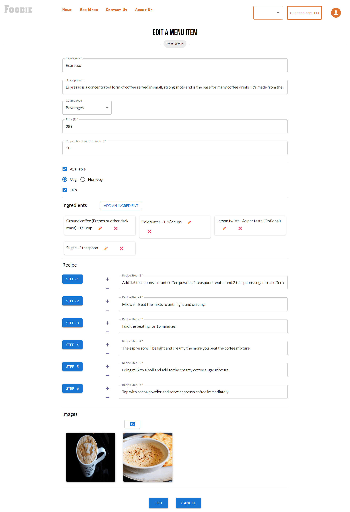
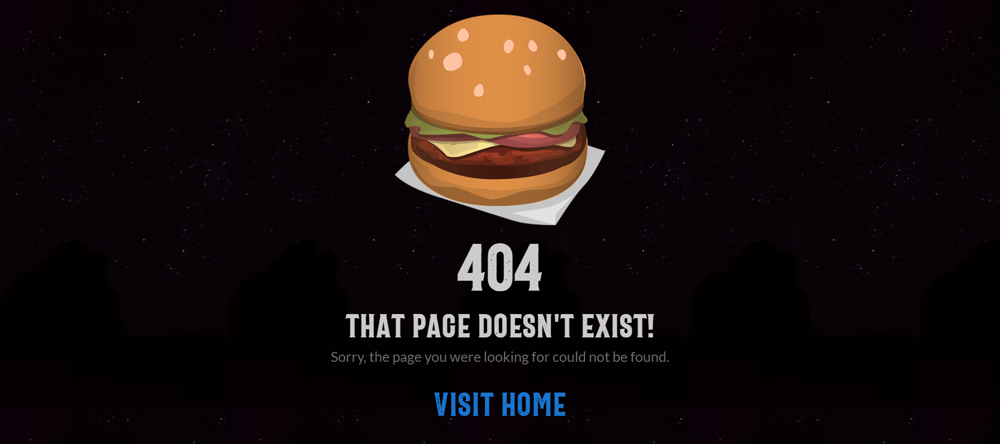

# 🍔 Foodie - Full-Stack MERN Restaurant Management Web Application

A full-stack, enterprise-grade restaurant management web application engineered with the **MERN Stack** (MongoDB, Express.js, React, Node.js), featuring **Redis** session caching, **Firebase** cloud media storage, **JWT** role-based authentication, and multi-language **i18n** localization.

---

## 📌 Badges


---

## 📸 Application Screenshots

<div align="center">

### Welcome & Landing Page


### Multi-Language Localization (Deutsch)


### User Authentication (Login & Registration)
| User Login | User Sign Up |
|---|---|
|  |  |

### Interactive Restaurant Menu Dashboard


### Administrative Menu Management
| Add New Dish | Edit Existing Dish |
|---|---|
|  |  |

### 404 Error Handling


</div>

---

## 🏗️ System Architecture

```
                    ┌────────────────────────────┐
                    │     Client Application     │
                    │   React 17 + Material-UI   │
                    │ i18next Localization (EN/DE)│
                    └─────────────┬──────────────┘
                                  │
                          HTTP / REST API
                                  │
                                  ▼
                    ┌────────────────────────────┐
                    │       Express Backend      │
                    │   Node.js + REST Routers   │
                    │  JWT + Role-Based Security │
                    └──────┬──────────────┬──────┘
                           │              │
             ┌─────────────┴──────┐       └──────────────┬─────────────┐
             ▼                    ▼                      ▼             ▼
   ┌─────────────────┐  ┌──────────────────┐   ┌──────────────┐  ┌───────────┐
   │ MongoDB Database│  │  Redis Cache DB  │   │Firebase Cloud│  │Nodemailer │
   │ Users, Menus,   │  │ Sessions (TTL),  │   │ Storage for  │  │ OTP Email │
   │ Categories      │  │ OTP verification │   │ Menu Images  │  │ Delivery  │
   └─────────────────┘  └──────────────────┘   └──────────────┘  └───────────┘
```

---

## ✨ Key Features & Capabilities

- **🔐 Robust Authentication & Authorization**:
  - Secure email & password signup with bcrypt hashing.
  - Social OAuth integration with **Google Sign-In** and **Facebook Login**.
  - **JWT (JSON Web Token)** based stateless API security.
  - Email verification and password recovery with time-limited **OTP** codes.

- **⚡ Redis-Powered Session Management**:
  - High-performance in-memory session tracking via Redis.
  - Dynamic Time-To-Live (TTL) renewal on authenticated user activity.
  - Safe session invalidation upon explicit logout.

- **🍽️ Full Menu Management (Admin)**:
  - Add, modify, inspect, and delete restaurant dishes.
  - Real-time image uploads integrated with **Firebase Cloud Storage**.
  - Categorization (Appetizers, Main Course, Desserts, Beverages).
  - Soft deletion protecting historic order integrity.

- **🌍 Multi-Language Internationalization (i18n)**:
  - Dynamic runtime language switching between **English** and **German (Deutsch)**.
  - Form validation messages and UI components localized via `react-i18next`.

- **🔍 Search, Filter, Sort & Pagination**:
  - Filter dishes by category, dietary preferences, or search keywords.
  - Responsive pagination and sorting by price or title.

- **🛡️ Enterprise Reliability & Design**:
  - Standardized error handling, input validation, and toast notifications (`notistack`).
  - Styled with Material-UI (MUI) components, Lato & Bebas Neue typography.
  - Graceful 404 page handling and route protection.

---

## 🛠️ Tech Stack & Dependencies

### Frontend (`client/`)
| Technology | Version | Purpose |
|---|---|---|
| **React** | `^17.0.2` | Core UI library |
| **Material-UI (MUI)** | `^5.5.3` | Responsive component styling and layout system |
| **react-router-dom** | `^6.2.2` | Client-side routing |
| **i18next & react-i18next**| `^21.6.14` | Internationalization & translation provider |
| **axios** | `^0.26.1` | REST API communication |
| **notistack** | `^2.0.3` | Snackbar toast notifications |
| **swiper** | `^8.1.0` | Mobile-friendly image carousels |

### Backend (`server/`)
| Technology | Version | Purpose |
|---|---|---|
| **Node.js & Express** | `^4.17.3` | REST API server |
| **MongoDB & Mongoose**| `^6.2.9` | NoSQL data modeling and persistence |
| **Redis** | `^4.0.6` | In-memory session store & OTP expiration caching |
| **Firebase SDK** | `^9.6.10` | Cloud Storage upload and image CDN URLs |
| **jsonwebtoken** | `^8.5.1` | Token generation and payload validation |
| **bcryptjs** | `^2.4.3` | Salted password hashing |
| **nodemailer** | `^6.7.3` | SMTP transport for OTP verification emails |
| **multer** | `^1.4.4` | Multipart form-data parser for media files |

---

## 🚀 Getting Started

### Prerequisites

Make sure you have the following installed locally:
- **Node.js** (v14+ recommended)
- **npm** or **yarn**
- **MongoDB** running locally or a [MongoDB Atlas](https://www.mongodb.com/cloud/atlas) connection URI
- **Redis Server** installed and running on default port `6379` (`redis-server`)

---

### 1. Clone the Repository

```bash
git clone https://github.com/Himanshu-Sharma12/Unified-Mentor2.git
cd Unified-Mentor2
```

---

### 2. Backend Server Setup

Navigate into the `server` directory and install dependencies:

```bash
cd server
npm install
```

Create a `.env` file in `server/`:

```env
SERVER_PORT=5000
MONGO_URL=mongodb://localhost:27017/restaurant_db
JWT_SECRET=your_jwt_super_secret_key_here
GOOGLE_CLIENT_ID=your_google_oauth_client_id
SMTP_EMAIL=your_email@gmail.com
SMTP_PASSWD=your_app_specific_email_password
```

Create a `FirebaseConfig.js` in the project root or server root with your Firebase storage credentials:

```javascript
module.exports = {
  apiKey: "your-api-key",
  authDomain: "your-app.firebaseapp.com",
  projectId: "your-project-id",
  storageBucket: "your-app.appspot.com",
  messagingSenderId: "your-sender-id",
  appId: "your-app-id"
};
```

Start the backend server in development mode (with nodemon):

```bash
npm run devstart
```

The server will initialize on `http://localhost:5000`.

---

### 3. Frontend Client Setup

Open a new terminal window, navigate into `client/`, and install dependencies:

```bash
cd client
npm install
```

Configure environment variables in `client/.env`:

```env
REACT_APP_GOOGLE_CLIENTID=your_google_oauth_client_id
REACT_APP_FACEBOOK_ID=your_facebook_app_id
```

Start the client development server:

```bash
npm start
```

The app will launch at `http://localhost:3000`.

---

## 📡 REST API Endpoints Overview

| Method | Endpoint | Description | Protected |
|---|---|---|---|
| `POST` | `/api/v1/user/register` | Register new user account | ❌ |
| `POST` | `/api/v1/user/login` | Authenticate user & issue JWT | ❌ |
| `POST` | `/api/v1/user/google-signin` | Authenticate with Google OAuth | ❌ |
| `POST` | `/api/v1/user/facebook-login` | Authenticate with Facebook OAuth | ❌ |
| `GET` | `/api/v1/user/current-user` | Fetch active user credentials | ✅ |
| `POST` | `/api/v1/user/erase-session` | Logout & invalidate Redis session | ✅ |
| `POST` | `/api/v1/otp/send-otp` | Dispatch email verification OTP | ❌ |
| `POST` | `/api/v1/otp/verify-otp` | Validate verification OTP | ❌ |
| `GET` | `/api/v1/menu-items` | Fetch all active restaurant dishes | ❌ |
| `POST` | `/api/v1/menu-items` | Add new menu item (Admin only) | ✅ |
| `PUT` | `/api/v1/menu-items/:id` | Update dish details (Admin only) | ✅ |
| `DELETE`| `/api/v1/menu-items/:id` | Soft delete dish (Admin only) | ✅ |
| `GET` | `/api/v1/categories` | Retrieve dish categories | ❌ |
| `POST` | `/api/v1/upload-image` | Upload dish image to Firebase | ✅ |

---

## 📁 Repository Structure

```
Unified-Mentor2/
├── client/                     # Frontend React Application
│   ├── public/                 # HTML shell, fonts, favicon
│   ├── src/
│   │   ├── components/         # Reusable UI components (auth, menu, navbar, footer)
│   │   ├── pages/              # Top-level view routes (Home, Welcome, Menu, 404)
│   │   ├── i18n/               # Localization dictionaries (en, de)
│   │   ├── App.js              # Routing and theme context provider
│   │   └── index.js            # React DOM bootstrapper
│   └── package.json            # Client dependencies & scripts
│
├── server/                     # Backend Express REST API
│   ├── src/
│   │   ├── middlewares/        # JWT auth, Redis session checks, Multer upload
│   │   ├── models/             # Mongoose schemas (User, MenuItem, Category)
│   │   ├── routes/             # Express API endpoints
│   │   ├── util/               # Redis client connection singleton
│   │   └── index.js            # Express server initialization
│   └── package.json            # Server dependencies & scripts
│
├── screenshots/                # Application UI demo screenshots
└── README.md                   # Project documentation
```

---

## 👨‍💻 Author

**Himanshu Sharma**  
- **GitHub**: [@Himanshu-Sharma12](https://github.com/Himanshu-Sharma12)  
- **Repository**: [Unified-Mentor2](https://github.com/Himanshu-Sharma12/Unified-Mentor2)

---

## 📄 License

This project is licensed under the [ISC License](LICENSE).
